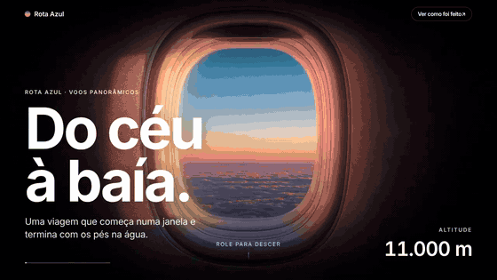
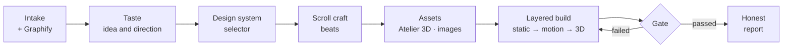
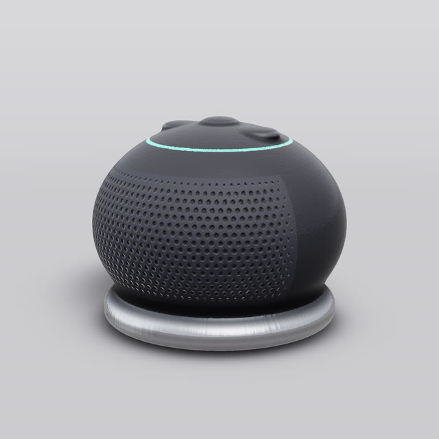
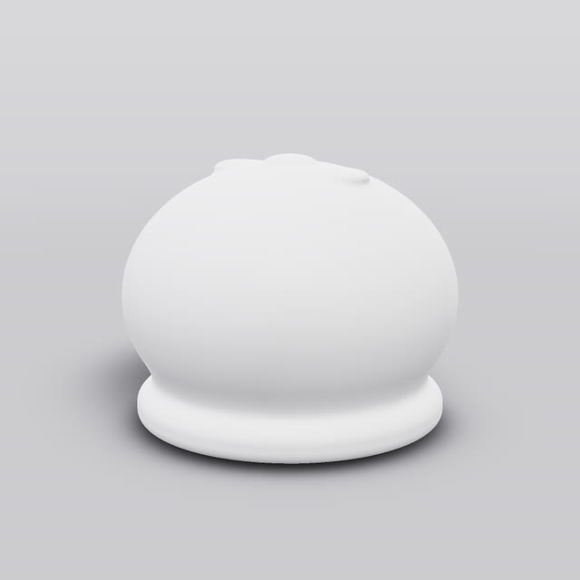
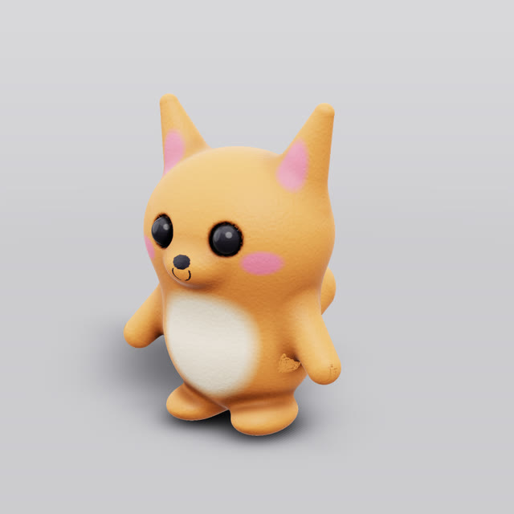

<p align="center">
  
</p>

<p align="center">
  <a href="README.pt-BR.md">Português</a> · <b>English</b>
</p>

<p align="center">
  <a href="LICENSE"></a>
  
  
  
  
</p>

<p align="center">
  <b>Art direction, scroll storytelling, verified design systems and a code-first 3D studio.</b><br>
  A Claude skill that decides, records and checks every choice instead of just generating pretty pixels.
</p>

<p align="center">
  <a href="https://rota-azul-demo.vercel.app"></a><br>
  <a href="https://rota-azul-demo.vercel.app"><b>▶ Click to open the live demo</b></a>
</p>

---

## What it is

`awwwards-skill` sits on top of the `incridible-skill` and `incridible-skill-3d` skills (GSAP components, starters, a real-browser inspector, a Three.js stage) and adds the layers that separate a correct website from an award-worthy one:

| Layer | What it does |
|---|---|
| **Taste** | Client inventory, three art directions, one idea sentence, one signature moment, and an anti-"template look" gate. |
| **Scroll craft** | Scroll beats, page structures, pins, frame sequences, 3D camera moves, budgets and fallbacks, plus the full [scroll-craft](https://github.com/nateherkai/scroll-craft) method and its dependency-free engine (bundled). |
| **UI motion craft** | How controls, menus, popovers, toasts and drags should move: when not to animate, easing, timing, review and audit skills from [Emil Kowalski](https://github.com/emilkowalski/skills) (bundled). |
| **Graft** | Port a feature from a public GitHub repo only after a licence, scope, stack, quality and maintenance gate. |
| **Graphify** | Map a site or repo before touching it (`scripts/codegraph.mjs`, works offline). |
| **6 design systems** | Apple, Google, Fluent 2, Atlassian, Salesforce and Meta's [Astryx](https://github.com/meta/astryx) behind one token contract, plus a selector that picks the best fit for the site. |
| **Atelier 3D** | Signed-distance modelling, PBR texture baking, LODs, silhouette-to-mesh and `.glb` export. Node only. |

## Live demo

**[rota-azul-demo.vercel.app](https://rota-azul-demo.vercel.app)** is a site built with this skill (the brand is fictional). Scrolling controls a video, the altitude readout counts down from 11,000 m to sea level, and the page falls back to three static scenes without JavaScript or with reduced motion. It uses the Apple tokens from this repo and no third-party libraries. Source: [`demo/`](demo/) (safe to delete if you only want the skill).

## How it works



Every decision is written to `.apex/decisions.md`: the idea sentence, the chosen design system, the scroll beats and the route for each 3D model. The gate runs a real-browser inspector at 1440, 768 and 390 px with real scrolling, a contrast audit and the 3D self-test before anything is called done.

## Six design systems, one contract

All six expose the same `--ds-*` CSS variables. Switching system means swapping **one file** (`tokens.css`). Light by default; dark through `[data-theme="dark"]` or `prefers-color-scheme`.

<p align="center">
  
</p>

| System | Best for | Notes |
|---|---|---|
| Apple HIG | Marketing, portfolios, image-led commerce, 3D product pages | [`ds/apple.md`](references/ds/apple.md) |
| Google Material 3 | Consumer flows, education, mobile web | [`ds/google.md`](references/ds/google.md) |
| Microsoft Fluent 2 | Dashboards, admin, fintech, healthcare | [`ds/fluent2.md`](references/ds/fluent2.md) |
| Atlassian | Collaboration, docs, devtools | [`ds/atlassian.md`](references/ds/atlassian.md) |
| Salesforce SLDS | CRM, ERP, record pages, long forms | [`ds/salesforce.md`](references/ds/salesforce.md) |
| Astryx (Meta) | Developer tools, SaaS, docs, React apps; a quiet grayscale canvas for brand-level theming | [`ds/astryx.md`](references/ds/astryx.md) |

**The selector** scores a primary system and says what to borrow from the others. Only mechanisms are borrowed, never colours, fonts or radii, so the site never looks assembled:

```console
$ node scripts/pick-design-system.mjs --type marketing --audience consumer --density airy \
    --tone premium-minimal --motion high --3d yes --ambition awwwards

Primary: Apple HIG  (score 23, confidence high)
Runner-up: Google Material 3 (12)

Borrow (mechanisms only):
  - colour roles and dark mode: from Google Material 3: tonal palette roles (primary, container, on-*)
  - component states: from Google Material 3: state layers: hover 8%, focus 10%, pressed 10%
  - focus and accessibility: from Microsoft Fluent 2: two-ring focus outline, forced-colors support
  - reduced motion: from Astryx (Meta): no travel, scale or spring; a cross-fade of 200 ms or less on touch
```

Every token file passes `scripts/contrast-check.mjs` (text 4.5:1, UI 3:1, light and dark). Astryx is the one system whose values come straight from published source (its Neutral theme, MIT), and the only one whose typeface (Figtree, SIL OFL) is open, so the font ships too. Add `--stack react` to the selector for a React app.

## Atelier: professional 3D in code, no Blender

Describe an object as a signed-distance field (SDF) plus a per-texel material function. Atelier does the rest: mesh, UVs, AO and curvature measured on the field, PBR textures (albedo, ORM, normal map), LODs and `.glb`.

<table>
  <tr>
    <td align="center"><br><sub>Product: 155k triangles, 5.6 MB</sub></td>
    <td align="center"><br><sub>The shape in clay, no textures</sub></td>
    <td align="center"><br><sub>Character: 113k triangles, 4.3 MB</sub></td>
  </tr>
</table>

<sub>Renders from the software previewer, made to review shape and material. The final production look comes from Three.js in `incridible-skill-3d`.</sub>

```bash
node scripts/atelier/atelier.mjs build scripts/atelier/models/speaker.mjs --lods 40000,12000
node scripts/atelier/atelier.mjs hull front.png side.png --height 1 --section round   # silhouettes → mesh
node scripts/atelier/atelier.mjs preview .apex/models/speaker.glb --clay
```

**Route ladder:** model in code → silhouettes to mesh → external generator (Tripo-class) + cleanup → Blender **only** if you ask for it.

## Install

Copy this folder into your Claude skills directory:

```bash
git clone https://github.com/joca-web/awwards-skill ~/.claude/skills/awwards-skill
```

The repository root is the skill folder (`SKILL.md` at the root). Requires Node.js (tested on v22). For the best results also install `incridible-skill` and `incridible-skill-3d`, which this skill loads and reuses. Without them the selector, tokens, Atelier, `codegraph` and the contrast audit still work.

## Use it

> *"Use awwwards-skill to build an Awwwards-level site for [brand], with a scroll-driven video and the Apple design system."*

> *"Model a [object] as a .glb, no Blender, with LODs and a cover image."*

> *"Map this repo with graphify before redesigning the home page."*

## Layout

```text
awwwards-skill/
├── SKILL.md                       # hub: workflow, rules, route choice
├── references/
│   ├── 01-taste.md                # directions, idea sentence, anti-slop, scorecard
│   ├── 02-scrollcraft.md          # beats, scroll devices, budgets
│   ├── 03-graft.md                # port GitHub features behind a licence gate
│   ├── 04-graphify.md             # code map before editing
│   ├── 05-design-systems.md       # token contract, selection, borrowing
│   ├── 06-3d-atelier.md           # SDF, materials, characters, hull, LODs
│   ├── 07-3d-generators.md        # Tripo-class route and cleanup without Blender
│   ├── 08-qa-gate.md              # gate and final report
│   ├── 09-blender-on-request.md   # Blender only when asked
│   ├── 10-ui-motion-craft.md      # how controls move (Emil Kowalski), routes to vendor/
│   ├── 11-scroll-craft-engine.md  # scroll-craft method and engine, fingerprint gate
│   └── ds/                        # apple · google · fluent2 · atlassian · salesforce · astryx
├── vendor/                        # third-party skills kept unchanged with their licences
│   ├── emilkowalski-skills/       # 19 skills + cheatsheets (MIT)
│   ├── scroll-craft/              # method, engine, harness (MIT)
│   └── astryx/                    # design records and the Neutral theme (MIT)
├── THIRD_PARTY_NOTICES.md
├── demo/                          # the live demo site (optional, not part of the skill)
├── scripts/
│   ├── pick-design-system.mjs     # design-system selector
│   ├── contrast-check.mjs         # WCAG audit of the tokens
│   ├── codegraph.mjs              # offline graphify (graph.json, report, HTML)
│   └── atelier/                   # atelier.mjs · selftest.mjs · lib/ · models/
└── assets/design-systems/         # tokens.css × 6 (Astryx also ships Figtree fonts)
```

## Verify

```bash
node scripts/atelier/selftest.mjs                              # end-to-end 3D pipeline
node scripts/contrast-check.mjs assets/design-systems/*/tokens.css
```

## Limits, stated plainly

- Atelier is very good at products, props and stylised characters. It is **not** a replacement for a learned generator such as Tripo on arbitrary organic shapes (a specific sneaker, faces, animals, food). The skill documents the generator route and `.glb` cleanup for those.
- Silhouette-to-mesh cannot recover concavities, and Atelier does not ingest external meshes for remeshing.
- Token values are audited approximations of the public systems, **not** official copies. Check each vendor's documentation when exact fidelity matters.
- WebGL and GSAP motion were not browser-tested in the authoring environment, and the normal-map direction follows the glTF convention without having been seen in a real viewer.
- The bundled scroll-craft engine and scripts were checked for syntax and for network and licence behaviour, but **not run** here. Its image and video generator (`kie.mjs`) calls the paid kie.ai API and is only to be used with your own key and your approval.
- Astryx is in Beta upstream, and several of its design records are marked draft. Three values in its `tokens.css` are derived and labelled as such.
- No evals or benchmarks have been run on the skill yet.

## Contributing

Issues and pull requests are welcome. See [CONTRIBUTING.md](CONTRIBUTING.md).

## Notices

Apple, Google, Microsoft, Atlassian, Salesforce and Meta are trademarks of their respective owners. This skill only reproduces public design principles and does not redistribute proprietary fonts or logos. A site "in the style of" a design system is not official vendor material.

**Bundled work by others.** `vendor/` carries unmodified material from [Emil Kowalski's skills](https://github.com/emilkowalski/skills) (MIT), [scroll-craft](https://github.com/nateherkai/scroll-craft) by Nate Herk (MIT) and [Astryx](https://github.com/meta/astryx) by Meta (MIT), and `assets/design-systems/astryx/fonts/` carries the Figtree typeface (SIL OFL 1.1). Each keeps its licence; see [THIRD_PARTY_NOTICES.md](THIRD_PARTY_NOTICES.md) and [vendor/README.md](vendor/README.md).

License: [MIT](LICENSE).
