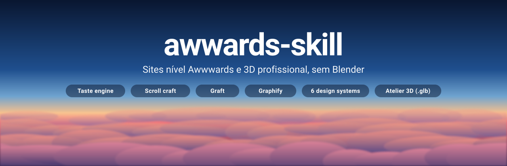
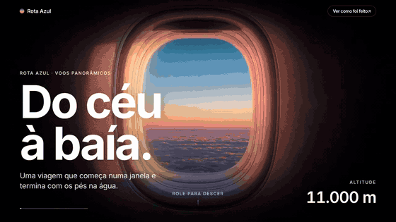
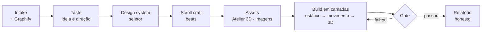
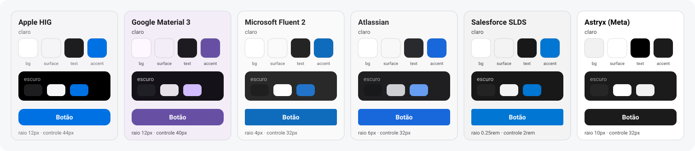
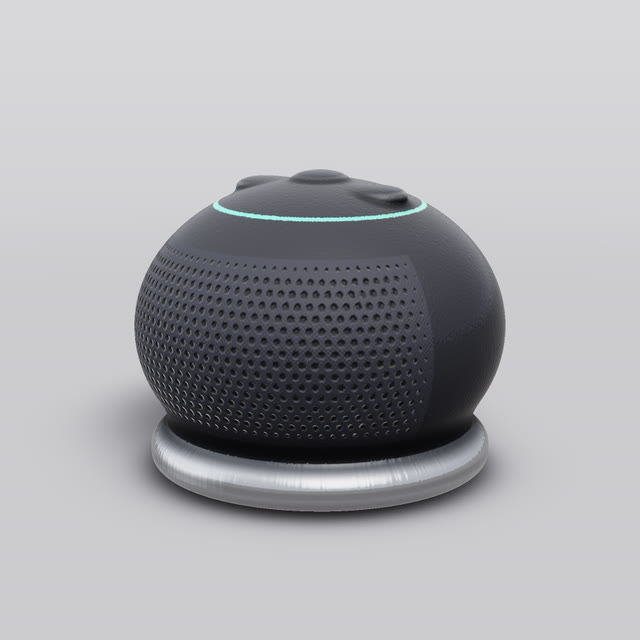
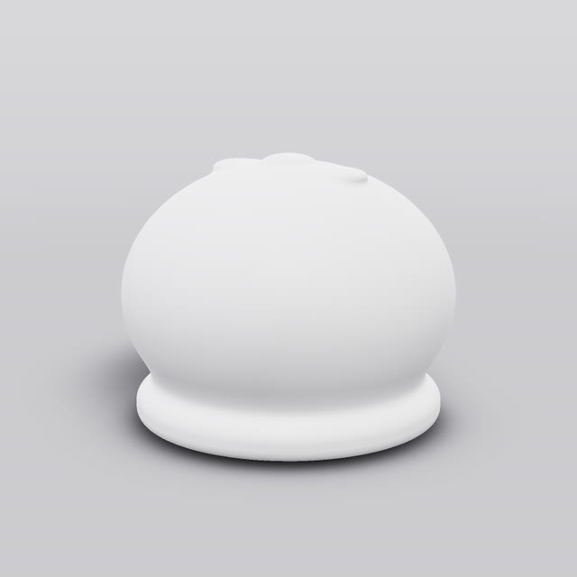
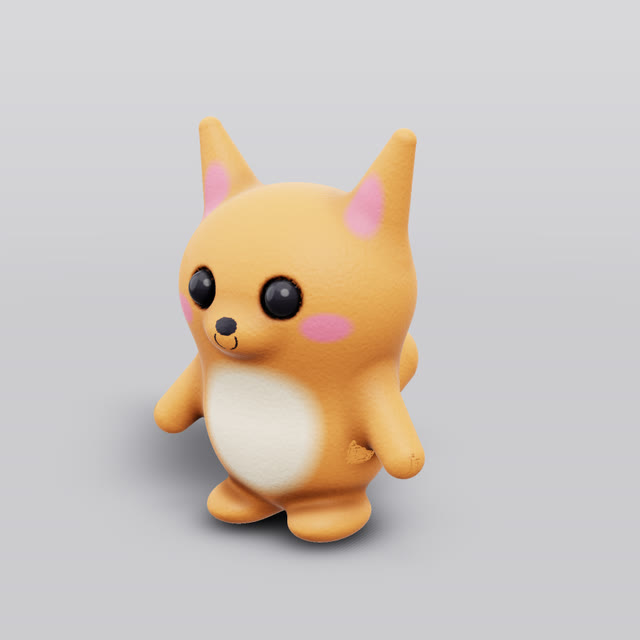

<p align="center">
  
</p>

<p align="center">
  
  
  
  
  
</p>

<p align="center">
  <b>Direção de arte, scroll storytelling, design systems verificados e um estúdio 3D em código.</b><br>
  Uma skill que decide, registra e confere cada escolha, em vez de só gerar pixels bonitos.
</p>

<p align="center">
  <a href="https://rota-azul-demo.vercel.app"></a><br>
  <a href="https://rota-azul-demo.vercel.app"><b>▶ Clique para abrir a demo ao vivo</b></a>
</p>

---

## O que é

`awwards-skill` fica por cima das skills `incridible-skill` e `incridible-skill-3d` (componentes GSAP, starters, inspetor em navegador real, palco Three.js) e acrescenta as camadas que separam um site correto de um site premiável:

| Camada | O que faz |
|---|---|
| **Taste** | Inventário do cliente, três direções, uma frase-ideia, um momento-assinatura e um gate contra o "visual de template". |
| **O kit padrão** | Todo site parte de um starter funcional com o Astryx: preloader antes do hero, scroll suave com GSAP + Lenis, transição de página (cortina ou View Transitions nativas), botões profissionais e um hero em Three.js com fallbacks. `node scripts/new-site.mjs <dir>` cria o projeto. |
| **Scroll craft** | Beats de scroll, estruturas de página, pins, sequências de quadros, câmera 3D, orçamentos e fallbacks, mais o método completo do [scroll-craft](https://github.com/nateherkai/scroll-craft) e seu motor sem dependências (incluídos). |
| **Movimento de interface** | Como botões, menus, popovers, toasts e arrastes devem se mover: quando não animar, curvas, tempos, e skills de revisão e auditoria de [Emil Kowalski](https://github.com/emilkowalski/skills) (incluídas). |
| **Graft** | Portar um recurso de um repositório público do GitHub só depois de passar por um gate de licença, escopo, stack, qualidade e manutenção. |
| **Graphify** | Mapear o site ou repositório antes de mexer (`scripts/codegraph.mjs`, funciona offline). |
| **6 design systems** | Apple, Google, Fluent 2, Atlassian, Salesforce e o [Astryx](https://github.com/meta/astryx) da Meta num mesmo contrato de tokens. **O Astryx é o padrão**; peça "mude o design system" e um seletor escolhe o melhor entre os outros. |
| **Atelier 3D** | Modelagem por campos de distância, texturas PBR, LODs, silhueta para malha e exportação `.glb`, só com Node. |

## Demo ao vivo

**[rota-azul-demo.vercel.app](https://rota-azul-demo.vercel.app)** é um site feito com esta skill (a marca é fictícia). O scroll controla um vídeo, a altitude cai de 11.000 m ao nível do mar, e a página vira três cenas estáticas sem JavaScript ou com movimento reduzido. Usa os tokens Apple deste repositório e nenhuma biblioteca de terceiros. Código: [`demo/`](demo/) (pode apagar se quiser só a skill).

## Como funciona



Toda decisão é escrita em `.apex/decisions.md`: a frase-ideia, o design system escolhido, os beats de scroll e a rota de cada modelo 3D. O gate roda o inspetor em 1440, 768 e 390 px com scroll real, a auditoria de contraste e o self-test do 3D antes de qualquer "pronto".

## Seis design systems, um contrato

Todos expõem as mesmas variáveis CSS `--ds-*`. Trocar de sistema é trocar **um arquivo** (`tokens.css`). Claro por padrão, escuro por `[data-theme="dark"]` ou `prefers-color-scheme`.

<p align="center">
  
</p>

| Sistema | Melhor para | Referência |
|---|---|---|
| Apple HIG | Marketing, portfólio, e-commerce com imagem forte, 3D de produto | [`ds/apple.md`](references/ds/apple.md) |
| Google Material 3 | Fluxos de consumo, educação, mobile web | [`ds/google.md`](references/ds/google.md) |
| Microsoft Fluent 2 | Dashboards, admin, fintech, saúde | [`ds/fluent2.md`](references/ds/fluent2.md) |
| Atlassian | Colaboração, documentação, devtools | [`ds/atlassian.md`](references/ds/atlassian.md) |
| Salesforce SLDS | CRM, ERP, telas de registro e formulários longos | [`ds/salesforce.md`](references/ds/salesforce.md) |
| Astryx (Meta) | Ferramentas de desenvolvimento, SaaS, documentação, apps React; base cinza e calma para temas de marca | [`ds/astryx.md`](references/ds/astryx.md) |

**O Astryx é usado primeiro em toda construção.** Se você não gostar, ou citar outro sistema, a skill troca. Quando você não cita nenhum, **o seletor** (`--exclude astryx`) pontua o sistema primário e diz o que emprestar dos outros. Só mecanismos entram, nunca cores, fontes ou raios, para o site não parecer "montado":

```console
$ node scripts/pick-design-system.mjs --type marketing --audience consumer --density airy \
    --tone premium-minimal --motion high --3d yes --ambition awwwards --exclude astryx

Primary: Apple HIG  (score 23, confidence high)
Runner-up: Google Material 3 (12)

Borrow (mechanisms only):
  - colour roles and dark mode: from Google Material 3: tonal palette roles (primary, container, on-*)
  - component states: from Google Material 3: state layers: hover 8%, focus 10%, pressed 10%
  - focus and accessibility: from Microsoft Fluent 2: two-ring focus outline, forced-colors support
  - reduced motion: from Astryx (Meta): no travel, scale or spring; a cross-fade of 200 ms or less on touch
```

Todos os tokens passam em `scripts/contrast-check.mjs` (texto 4.5:1, interface 3:1, nos temas claro e escuro). O Astryx é o único sistema cujos valores vêm direto de código publicado (o tema Neutral, MIT) e o único com tipografia aberta (Figtree, SIL OFL), por isso a fonte também vai junto. Use `--stack react` no seletor para um app React.

## Atelier: 3D profissional em código, sem Blender

Descreva o objeto como um campo de distância (SDF) e uma função de material por texel. O Atelier faz o resto: malha, UVs, AO e curvatura medidos no campo, texturas PBR (albedo, ORM, normal map), LODs e `.glb`.

<table>
  <tr>
    <td align="center"><br><sub>Produto: 155 mil triângulos, 5,6 MB</sub></td>
    <td align="center"><br><sub>A forma em argila, sem textura</sub></td>
    <td align="center"><br><sub>Personagem: 113 mil triângulos, 4,3 MB</sub></td>
  </tr>
</table>

<sub>Renders do previewer em software, feitos para revisão de forma e material. O visual final de produção vem do Three.js da `incridible-skill-3d`.</sub>

```bash
node scripts/atelier/atelier.mjs build scripts/atelier/models/speaker.mjs --lods 40000,12000
node scripts/atelier/atelier.mjs hull frente.png lado.png --height 1 --section round   # silhuetas → malha
node scripts/atelier/atelier.mjs preview .apex/models/speaker.glb --clay
```

**Escada de rotas:** modelo em código → silhueta para malha → gerador externo (Tripo-class) + limpeza → Blender **somente** se você pedir.

## Instalação

Copie esta pasta para o diretório de skills do Claude:

```bash
git clone https://github.com/joca-web/awwards-skill ~/.claude/skills/awwards-skill
```

A raiz do repositório já é a pasta da skill (`SKILL.md` na raiz). Requer Node.js (testado na v22). Para o melhor resultado, instale também `incridible-skill` e `incridible-skill-3d`, que a skill carrega e reaproveita; sem elas, o seletor, os tokens, o Atelier, o `codegraph` e a auditoria de contraste continuam funcionando.

## Como usar

> *"Use a awwards-skill para criar um site nível Awwwards para [marca], com um vídeo guiado por scroll e a identidade do Apple design system."*

> *"Crie um modelo 3D de [objeto] em .glb, sem Blender, com LODs e uma imagem de capa."*

> *"Mapeie este repositório com o graphify antes de redesenhar a página inicial."*

## Estrutura

```text
awwards-skill/
├── SKILL.md                       # hub: fluxo, regras e escolha de rota
├── references/
│   ├── 01-taste.md                # direções, frase-ideia, anti-slop, scorecard
│   ├── 02-scrollcraft.md          # beats, dispositivos de scroll, orçamentos
│   ├── 03-graft.md                # portar recursos do GitHub com gate de licença
│   ├── 04-graphify.md             # mapa de código antes de editar
│   ├── 05-design-systems.md       # contrato de tokens, seleção, empréstimo
│   ├── 06-3d-atelier.md           # SDF, materiais, personagens, hull, LODs
│   ├── 07-3d-generators.md        # rota Tripo-class e limpeza sem Blender
│   ├── 08-qa-gate.md              # gate e relatório final
│   ├── 09-blender-on-request.md   # Blender só sob pedido
│   ├── 10-ui-motion-craft.md      # como os controles se movem (Emil Kowalski), aponta para vendor/
│   ├── 11-scroll-craft-engine.md  # método e motor do scroll-craft, gate de impressão digital
│   └── ds/                        # apple · google · fluent2 · atlassian · salesforce · astryx
├── vendor/                        # skills de terceiros mantidas sem alteração, com suas licenças
│   ├── emilkowalski-skills/       # 19 skills + cheatsheets (MIT)
│   ├── scroll-craft/              # método, motor, ferramentas de verificação (MIT)
│   └── astryx/                    # registros de design e o tema Neutral (MIT)
├── THIRD_PARTY_NOTICES.md
├── demo/                          # o site da demo ao vivo (opcional, não faz parte da skill)
├── scripts/
│   ├── new-site.mjs               # cria um site a partir de assets/starter
│   ├── pick-design-system.mjs     # seletor de design system
│   ├── contrast-check.mjs         # auditoria WCAG dos tokens
│   ├── codegraph.mjs              # graphify offline (graph.json, relatório, HTML)
│   └── atelier/                   # atelier.mjs · selftest.mjs · lib/ · models/
├── assets/starter/                # preloader · Lenis + GSAP · transições · botões · hero Three.js
└── assets/design-systems/         # tokens.css × 6 (o Astryx também traz as fontes Figtree)
```

## Verificação

```bash
node scripts/atelier/selftest.mjs                              # pipeline 3D de ponta a ponta
node scripts/contrast-check.mjs assets/design-systems/*/tokens.css
```

## Limites, ditos com clareza

- O Atelier faz muito bem produtos, props e personagens estilizados. **Não substitui** um gerador aprendido como o Tripo em formas orgânicas arbitrárias (um tênis específico, rostos, animais, comida). Para isso a skill documenta a rota com gerador e a limpeza do `.glb`.
- Silhueta para malha não recupera concavidades, e o Atelier não aceita malhas externas para remalhar.
- Os valores dos tokens são aproximações auditadas dos sistemas públicos, **não** cópias oficiais. Confira na documentação de cada fabricante quando a fidelidade exata importar.
- Os movimentos de WebGL e GSAP não foram testados em navegador no ambiente de criação, e a direção do normal map segue a convenção glTF, sem ter sido vista num viewer real.
- O motor e os scripts do scroll-craft incluídos tiveram a sintaxe e o comportamento de rede e licença conferidos, mas **não foram executados** aqui. O gerador de imagem e vídeo dele (`kie.mjs`) chama a API paga kie.ai e só deve ser usado com a sua chave e a sua aprovação.
- O Astryx está em Beta e vários registros de design dele estão marcados como rascunho. Três valores do `tokens.css` dele são derivados e estão identificados como tal.
- Não foram rodadas avaliações nem benchmarks da skill.

## Avisos

Apple, Google, Microsoft, Atlassian, Salesforce e Meta são marcas dos respectivos donos. Esta skill só reproduz princípios públicos de design e não redistribui fontes ou logotipos proprietários. Um site "no estilo de" um design system não é material oficial do fabricante.

**Material de terceiros incluído.** `vendor/` traz, sem alterações, as [skills de Emil Kowalski](https://github.com/emilkowalski/skills) (MIT), o [scroll-craft](https://github.com/nateherkai/scroll-craft) de Nate Herk (MIT) e o [Astryx](https://github.com/meta/astryx) da Meta (MIT), e `assets/design-systems/astryx/fonts/` traz a fonte Figtree (SIL OFL 1.1). Cada um mantém a sua licença; veja [THIRD_PARTY_NOTICES.md](THIRD_PARTY_NOTICES.md) e [vendor/README.md](vendor/README.md).

Licença: [MIT](LICENSE).
